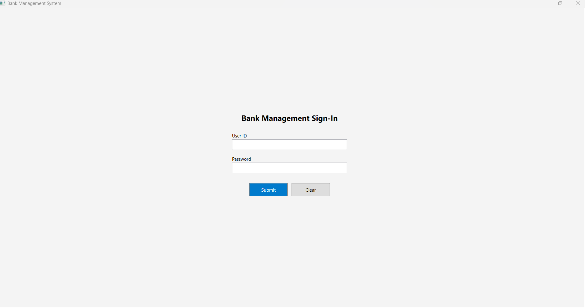
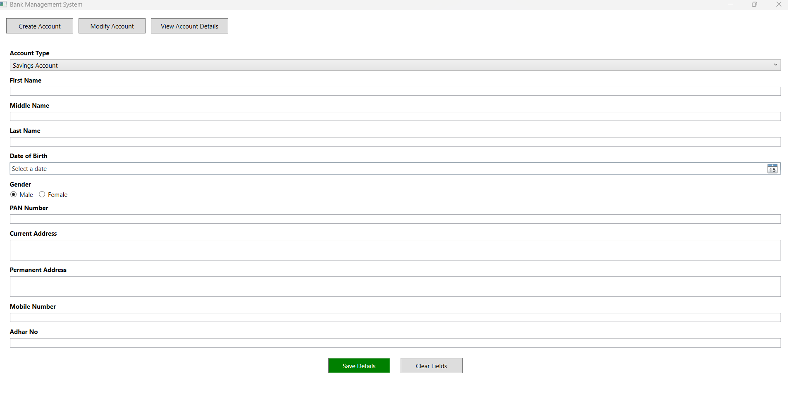
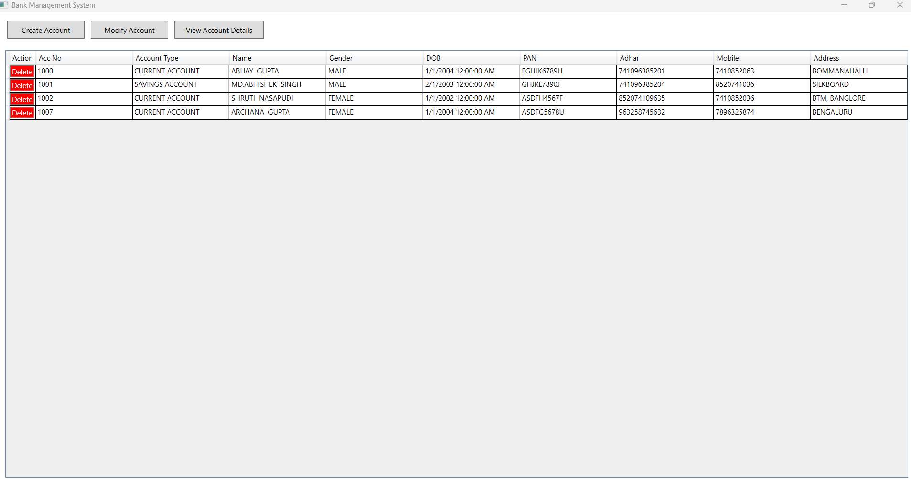

# 🏦 Banking Account Management System

**Author:** Abhay  

## Project Overview
This application is a robust Account Management system designed to handle banking customer records with high data integrity and strict validation rules.

## Key 🚀 Features Implemented

### 1. Full CRUD Operations
*   **Create:** New accounts with auto-generated 4-digit Account Numbers.
*   **Modify:** Update existing user details via the Management interface.
*   **View:** A comprehensive DataGrid displaying all 11+ required fields.
*   **Delete:** Secure deletion with professional confirmation prompts.

### 2. Data Integrity & Formatting
*   **Automated Uppercase:** All string data (Names, Address, PAN) is converted to UPPERCASE before database persistence.
*   **Professional Navigation:** Unified UI driven by Action Buttons (Create/Modify/View).

### 3. Strict Validation
*   **Mobile:** 10-digit validation starting with 6-9.
*   **PAN:** Validates standard Indian PAN format (5 Letters, 4 Digits, 1 Letter).
*   **Names:** Minimum 3-character requirement.
*   **Age:** Restricted to the 5–80 years bracket.

## 🛠️ Tech Stack

| Layer | Technology |
| :--- | :--- |
| **Frontend** | WPF, XAML |
| **Backend** | C#, .NET Core |
| **Database** | Entity Framework Core, SQL Server (LocalDB) |
| **Dev Tools** | Visual Studio 2022, Git, GitHub |

## 📸 Screenshots

**1. Sign-In Screen**

**2. Account Registration & Modification**

**3. Account Details Dashboard**

## Setup Instructions

### Option 1: Using Entity Framework Core (Recommended)
1. Extract the project ZIP folder.
2. Open `BankAssignment.sln` in Visual Studio 2022.
3. Open the **Package Manager Console** (`Tools > NuGet Package Manager`).
4. Execute the command: `Update-Database`
   *(This will automatically create the `BankAssignmentDB` and table schema).*
5. Press `F5` to Run the application.

### Option 2: Using the Provided SQL Script / Database ZIP
1. Extract the provided database ZIP file or locate the `.sql` script in the repository.
2. Open **SQL Server Management Studio (SSMS)** and connect to your LocalDB instance (`(localdb)\MSSQLLocalDB`).
3. Execute the provided SQL script to manually generate the `BankAssignmentDB` schema and tables.
4. Update the connection string in `App.config` or `appsettings.json` if your server name differs.
5. Open `BankAssignment.sln` in Visual Studio and press `F5` to run.

## Notes
*   The application uses Entity Framework Core Migrations to manage the schema.
*   Database connection defaults to SQL Server LocalDB (Trusted Connection).